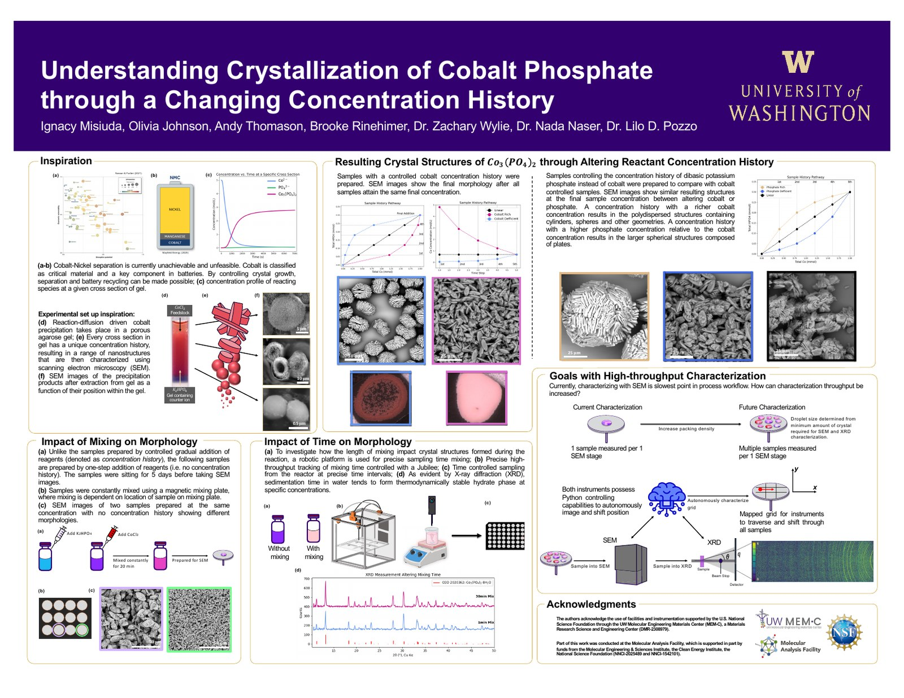

Ignacy Misiuda and Team Critical won second place in the Best Undergraduate Student Poster Award at the 2026 Chemical Engineering Undergraduate Poster Session (CHEM-UPS), held on November 19, 2026, at the University of Washington in Seattle. Their poster was titled "Understanding Crystallization of Cobalt Phosphate through a Changing Concentration History."

Cobalt is a critical material and a key component of batteries, but separating it from nickel, which would make battery recycling possible, is not yet feasible. Controlling how cobalt crystals grow could change that. The project took its inspiration from cobalt precipitating in an agarose gel, where every cross section of the gel sees a different concentration history and grows different nanostructures. The team recreated those histories in solution by adding cobalt chloride or dibasic potassium phosphate step by step. Scanning electron microscopy (SEM) showed that cobalt-rich histories produce a mix of cylinders, spheres and other shapes, while phosphate-rich histories produce larger spheres built from plates. The team also used a Jubilee robotic platform to sample reactions at precisely timed intervals, and X-ray diffraction to follow how mixing and time change the crystal phases. Next, they are working on automating SEM and X-ray diffraction measurements of many samples at once to speed up characterization.

<figure class="mb-4">
  
  <figcaption class="text-muted small mt-2">The award-winning poster (click to enlarge).</figcaption>
</figure>

The poster's authors are Ignacy Misiuda, Olivia Johnson, Andy Thomason and Brooke Rinehimer, with Dr. Zachery Wylie, Dr. Nada Naser and Prof. Lilo D. Pozzo. The work used the facilities of the UW Molecular Engineering Materials Center (MEM-C) and the Molecular Analysis Facility.

The award was presented by UW Chemical Engineering and the advisors of the department's student chapter of the American Institute of Chemical Engineers (AIChE).

Congratulations, Ignacy and Team Critical!
